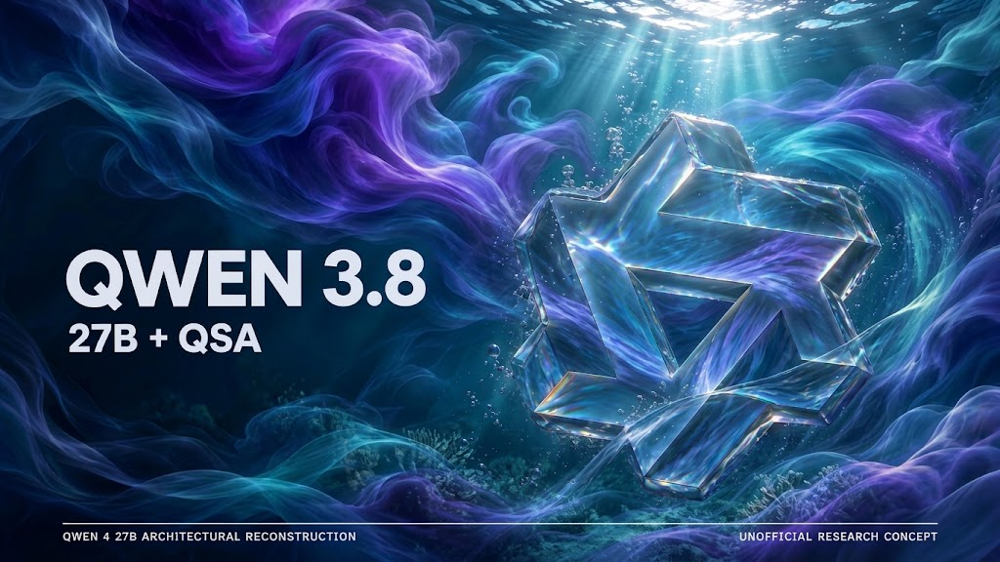
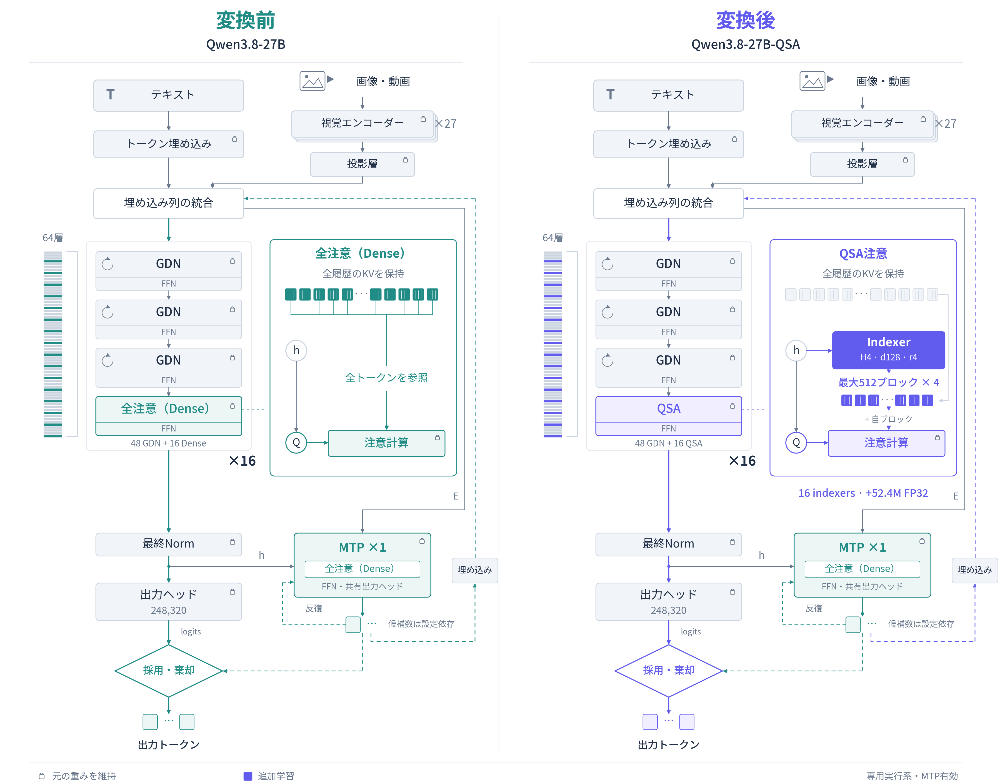
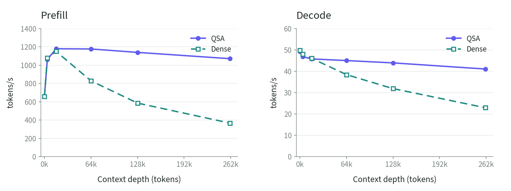

# Qwen3.8-27B QSA for llama.cpp



[English](README.md) | [日本語](README.ja.md)

[推論エンジン](https://github.com/kuraneko1/Qwen3.8-27B-QSA-llama.cpp) | [GGUFと実行環境](https://huggingface.co/higa2515/Qwen3.8-27B-QSA-GGUF) | [BF16 weights](https://huggingface.co/higa2515/Qwen3.8-27B-QSA-BF16) | [QSA論文](https://arxiv.org/abs/2608.30320) | [X](https://x.com/_ryu15_)

このリポジトリはQSA・マルチモーダル入力・MTP・稼働中のprefixキャッシュ再利用に対応したQwen3.8-27B向けの専用llama.cpp推論エンジンです。重みと収録済みruntimeは[GGUFリリース](https://huggingface.co/higa2515/Qwen3.8-27B-QSA-GGUF)からダウンロードできます。

## QSAの概要

Qwen Sparse Attention（QSA）は、学習済みの圧縮indexerを使って4トークン単位のblockからコンテキストを選択します。この27Bへの適応では、16個の全注意層が固定K=2,048のトークン予算と現在のblockを使い、残る48層のGated DeltaNet構造を保持しています。

KVはすべて保持するため、QSAはKVキャッシュを圧縮する方式ではありません。注意計算とKV読み出しを減らす方式です。nativeエンジンはM-RoPEに対応したテキスト・画像・動画、最大2個のdraft tokenを使うMTP、1つの稼働中slotでの本体・indexer・MTPキャッシュ再利用をサポートします。このキャッシュはディスクには保存されず、サーバー再起動後には引き継がれません。



左が元のQwen3.8-27B、右が16個の学習済みindexerを追加したQSA版です。

## クイックインストールと起動

収録済みruntimeの対象はLinux x86_64とNVIDIA sm70です。検証済みの構成では32GB GPU 2台、CUDA 12.9、FP16 KV、262,144トークンのコンテキストを使用します。Hugging Face CLIをインストールし、リリースのダウンロードとhash確認をしてからサーバーを起動してください。

```sh
python3 -m pip install --user -U huggingface_hub
hf download higa2515/Qwen3.8-27B-QSA-GGUF --local-dir qsa27b
cd qsa27b
sha256sum -c SHA256SUMS
tar -xzf qsa27b-linux-x86_64-sm70.tar.gz
QSA_MODEL_DIR="$PWD" ./qsa27b-runtime/launch.sh
```

サーバーの既定の待受先は127.0.0.1:8091で、OpenAI互換APIは`http://127.0.0.1:8091/v1`です。外部から利用するときだけ`QSA_HOST=0.0.0.0`を設定してください。同じGPUでは別のモデルを同時に実行しないでください。

## ソースからビルド

収録済みのsm70バイナリが対象環境に合わない場合はソースからビルドしてください。CMake、Ninja、C++コンパイラ、CUDA 12.9 toolkitが必要です。

```sh
git clone https://github.com/kuraneko1/Qwen3.8-27B-QSA-llama.cpp.git
cd Qwen3.8-27B-QSA-llama.cpp
CUDA_HOME=/usr/local/cuda-12.9 bash qsa27b/build.sh
```

既定のバイナリは`build-qsa/bin/llama-server`です。`QSA_BIN`を指定すると、ビルドしたバイナリでも同じ起動設定を使えます。

```sh
QSA_BIN="$PWD/build-qsa/bin/llama-server" \
QSA_MODEL_DIR=/path/to/gguf \
bash qsa27b/launch-captured-runtime.sh
```

`QSA_BUILD_DIR`、`QSA_CUDA_ARCH`、`QSA_BUILD_JOBS`でビルド設定を変更できます。ソースからの新規ビルドが収録済みバイナリとbyte単位で一致するという意味ではありません。変換と検証の詳細は[ランタイムガイド](qsa27b/RUNTIME.md)を参照してください。

## 実測結果

### 限定的な品質確認

BF16研究参照版で元のdense経路と比較した結果です。Q8_0 nativeの品質結果ではありません。

| 確認項目 | 元のdense | QSA | 観測された比較 |
| --- | ---: | ---: | --- |
| 32,766トークンのテキストPPL（低いほどよい） | 7.072960 | 7.071384 | QSA/dense比0.99978 |
| 構成した50問の4択DocVQA | 50/50 | 50/50 | このprobeではdenseの100% |

DocVQAの結果は標準の自由回答DocVQAによる評価ではありません。これらの小規模な確認から、一般的な性能維持率や広範な品質同等性を示すことはできません。nativeのマルチモーダル確認は64kまでの限定的なprobeにとどまります。

### テキスト速度のQSA・Dense比較

両方の経路で同じQ8_0 GGUF、FP16 KV、MTP draft2、エンジン、sm70の32GB GPU 2台を使用しました。Denseは`LLAMA_QSA_DENSE=1`で元の16個の全注意層を通常attentionに戻した対照です。48個のGated DeltaNet層は両方で保持しています。課題はコード2種類と散文2種類を混合しました。

| 入力トークン | QSA cold prefill | Dense cold prefill | QSA decode | Dense decode |
| ---: | ---: | ---: | ---: | ---: |
| 0 | 660.75 | 658.87 | 49.28 | 49.87 |
| 261,120 | 1071.53 | 366.84 | 41.07 | 22.91 |

単位はすべてtoken/sです。261,120入力トークンでは、QSAはdecodeが1.793倍、cold prefillが2.921倍でした。それぞれ再測定した0k時点からの混合decode低下率は、QSAが16.66%、Denseが54.06%です。0kのpromptにも490〜563 tokenが含まれます。

QSAの0以外の深度は以前の同条件runの測定値を使い、QSAとDenseは別セッションで測りました。同時・交互の反復A/Bではないため、信頼区間や一般的な品質の主張はしません。[比較データと方法](https://huggingface.co/higa2515/Qwen3.8-27B-QSA-GGUF/tree/main/benchmark)も公開しています。



## ContributorsとCredits

- [kuraneko1](https://github.com/kuraneko1): QSA 27B統合、マルチモーダルruntime、リリース工程。
- [pentaCoxian](https://github.com/pentaCoxian): V100向けllama.cpp基盤とruntime最適化。
- [Warabii1248](https://github.com/Warabii1248): 基盤エンジンに取り込まれたV100 patch群。
- [ggml-org contributors](https://github.com/ggml-org/llama.cpp): 上流のllama.cpp。
- [Qwen](https://huggingface.co/Qwen/Qwen3.8-27B): 元モデルとQSAアーキテクチャの参照元。

上流のREADMEは[README.upstream.md](README.upstream.md)に保存しています。エンジンコードはMITとthird-party noticesを保持し、モデルファイルはApache-2.0を保持します。
