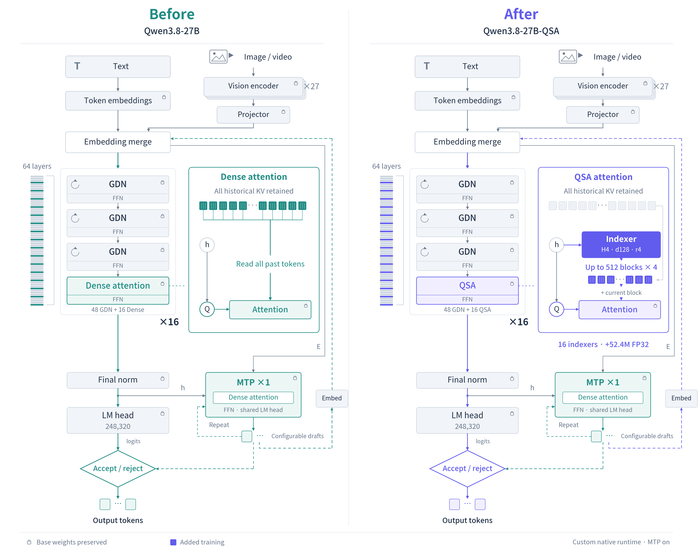
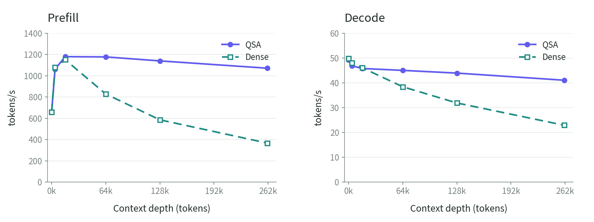

# Qwen3.8-27B QSA for llama.cpp

[English](README.md) | [日本語](README.ja.md)

[Inference Engine](https://github.com/kuraneko1/Qwen3.8-27B-QSA-llama.cpp) | [GGUF + Runtime](https://huggingface.co/higa2515/Qwen3.8-27B-QSA-GGUF) | [BF16 Weights](https://huggingface.co/higa2515/Qwen3.8-27B-QSA-BF16) | [QSA Paper](https://arxiv.org/abs/2608.30320) | [X](https://x.com/_ryu15_)

This repository is the custom llama.cpp inference engine for Qwen3.8-27B with QSA, multimodal input, MTP, and live prefix-cache reuse. Download the weights and captured runtime from the [GGUF release](https://huggingface.co/higa2515/Qwen3.8-27B-QSA-GGUF).

## QSA in brief

Qwen Sparse Attention (QSA) uses a learned, compressed indexer to select context in four-token blocks. In this 27B adaptation, the 16 full-attention layers use a fixed token budget of K=2,048 plus the current block. The other 48 Gated DeltaNet layers retain their architecture.

All KV entries remain allocated. QSA reduces attention computation and KV reads; it does not compress the KV cache. The native engine supports text, images, and video with M-RoPE, MTP with up to two draft tokens, and target/indexer/MTP cache reuse in one live slot. The cache is not stored on disk and does not survive a server restart.



Original Qwen3.8-27B (left) and the QSA adaptation with 16 learned indexers (right).

## Quick install and start

The captured runtime targets Linux x86_64 and NVIDIA sm70. Its validated configuration uses two 32GB GPUs, CUDA 12.9, FP16 KV, and a 262,144-token context. Install the Hugging Face CLI, download the release, verify its hashes, and start the server:

```sh
python3 -m pip install --user -U huggingface_hub
hf download higa2515/Qwen3.8-27B-QSA-GGUF --local-dir qsa27b
cd qsa27b
sha256sum -c SHA256SUMS
tar -xzf qsa27b-linux-x86_64-sm70.tar.gz
QSA_MODEL_DIR="$PWD" ./qsa27b-runtime/launch.sh
```

The server listens on 127.0.0.1:8091 by default, with the OpenAI-compatible API at `http://127.0.0.1:8091/v1`. Set `QSA_HOST=0.0.0.0` only when remote access is required. Do not run another model on the same GPUs.

## Build from source

Use a source build when the captured sm70 binary does not match the target system. CMake, Ninja, a C++ compiler, and the CUDA 12.9 toolkit are required.

```sh
git clone https://github.com/kuraneko1/Qwen3.8-27B-QSA-llama.cpp.git
cd Qwen3.8-27B-QSA-llama.cpp
CUDA_HOME=/usr/local/cuda-12.9 bash qsa27b/build.sh
```

The default binary is `build-qsa/bin/llama-server`. Use the same launch settings with that binary by setting `QSA_BIN`:

```sh
QSA_BIN="$PWD/build-qsa/bin/llama-server" \
QSA_MODEL_DIR=/path/to/gguf \
bash qsa27b/launch-captured-runtime.sh
```

`QSA_BUILD_DIR`, `QSA_CUDA_ARCH`, and `QSA_BUILD_JOBS` customize the build. A fresh source build is not claimed to reproduce the captured binary byte-for-byte. See the [runtime guide](qsa27b/RUNTIME.md) for conversion and verification details.

## Measured results

### Limited quality checks

These are BF16 research-reference comparisons against the original dense path, not Q8_0 native quality results.

| Check | Original dense | QSA | Observed comparison |
| --- | ---: | ---: | --- |
| Text PPL on 32,766 tokens, lower is better | 7.072960 | 7.071384 | QSA/dense ratio 0.99978 |
| Constructed 50-item four-choice DocVQA | 50/50 | 50/50 | 100% of the dense score on this probe |

The DocVQA probe is not standard open-ended DocVQA scoring. These small checks do not establish a general performance-retention percentage or broad quality equivalence. Native multimodal probes are limited to checks through 64k.

### Text throughput: QSA vs dense

The same Q8_0 GGUF, FP16 KV, MTP draft2, engine, and two sm70 32GB GPUs were used for both paths. Dense restores the 16 original full-attention layers with `LLAMA_QSA_DENSE=1`; the 48 Gated DeltaNet layers stay unchanged. The workload mixed two coding tasks and two free-prose tasks.

| Input tokens | QSA cold prefill | Dense cold prefill | QSA decode | Dense decode |
| ---: | ---: | ---: | ---: | ---: |
| 0 | 660.75 | 658.87 | 49.28 | 49.87 |
| 261,120 | 1071.53 | 366.84 | 41.07 | 22.91 |

All values are token/s. At 261,120 input tokens, QSA was 1.793x faster in decode and 2.921x faster in cold prefill. From each path's re-measured 0k point, mixed decode declined 16.66% for QSA and 54.06% for dense. The 0k prompts still contain 490-563 tokens.

QSA's nonzero-depth samples were retained from the earlier matched run; QSA and dense were measured in separate sessions, not interleaved A/B repeats. No confidence interval or general quality claim is made. See the [full comparison data and methodology](https://huggingface.co/higa2515/Qwen3.8-27B-QSA-GGUF/tree/main/benchmark).



## Contributors and credits

- [kuraneko1](https://github.com/kuraneko1): QSA 27B integration, multimodal runtime, and release engineering.
- [pentaCoxian](https://github.com/pentaCoxian): V100-oriented llama.cpp base and runtime optimizations.
- [Warabii1248](https://github.com/Warabii1248): V100 patch series included in the base engine.
- [ggml-org contributors](https://github.com/ggml-org/llama.cpp): upstream llama.cpp.
- [Qwen](https://huggingface.co/Qwen/Qwen3.8-27B): original model and QSA architecture reference.

The upstream README is preserved in [README.upstream.md](README.upstream.md). Engine code retains MIT and third-party notices. Model files retain Apache-2.0.
